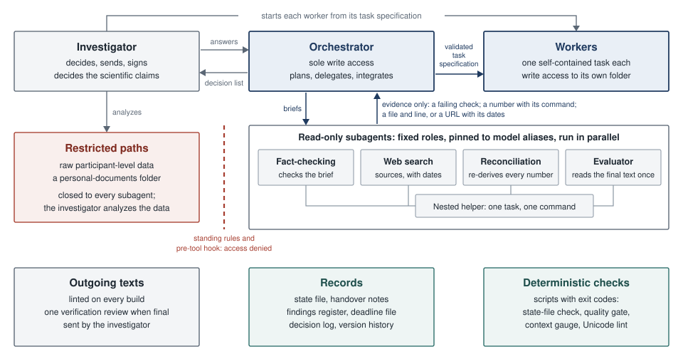

# Exit-Code Orchestration

An architecture of controls, records and verification for AI agents in research operations

<strong class="name">Raz Balin</strong>, doctoral researcher in neuroscience

ORCID <a href="https://orcid.org/0000-0001-8895-1537">0000-0001-8895-1537</a> · <a href="https://razbalin.com">razbalin.com</a> · <a href="https://www.linkedin.com/in/razbalin">www.linkedin.com/in/razbalin</a>

<table class="meta">
<tr class="row"><th scope="row">Type</th><td class="val">Method note, version 1.0.0</td></tr>
<tr class="row"><th scope="row">DOI</th><td class="val"><a href="https://doi.org/10.5281/zenodo.24239347">https://doi.org/10.5281/zenodo.24239347</a></td></tr>
<tr class="row"><th scope="row">Date</th><td class="val">November 2026</td></tr>
<tr class="row"><th scope="row">Repository</th><td class="val"><a href="https://github.com/RazBalin/exit-code-orchestration">github.com/RazBalin/exit-code-orchestration</a></td></tr>
<tr class="row"><th scope="row">Licenses</th><td class="val">Note and figure CC BY 4.0 · repository code MIT, documentation CC BY 4.0</td></tr>
</table>

## Summary

This note describes the design and operation of Exit-Code Orchestration, a multi-agent AI system for scientific and engineering production work, built on the orchestrator-worker pattern. An orchestrator holds sole write access; workers carry self-contained tasks from validated task specifications; read-only subagents, verification agents among them, do the reading and return evidence. Decisions travel as requests with considered options, and the answers form the decision log; records are auditable; continuity between working sessions lives in bounded state files that a script checks. Every control is a deterministic check with an exit code, run outside any model. Access is bounded by design: restricted paths are denied to every subagent by a pre-tool hook before a call runs, and text that an agent reads is treated as data, never as an instruction. In a comparison of twenty families of published systems for AI-assisted research (8 and 9 November 2026), none showed such an enforced boundary together with a stance on instructions planted in what agents read, in the sources read; eleven showed part of one.

The architecture serves research operations, records and verification; every scientific claim, with the evidence it rests on, is decided by the investigator. I apply it daily to my research program and the projects I work in: 64 AI-orchestrated working sessions on one research program in eight weeks (September to November 2026). The note reports the system's operating cost in tokens, the failures its controls caught, with counts over its four findings registers (3,460 items), a pilot comparison against a baseline, and its limitations. A generic, runnable skeleton of the architecture, with its tests, continuous integration and one recorded example session, accompanies the note.

In the pilot, the architecture and a baseline ran the same agent harness, the same locally served open-weight model and the same web tools, three times each, on 25 held-out web-research questions, six pages carrying planted instructions and one task spread over two sessions. Both found the right answer about equally often (74 and 73 of 75 answers), but the architecture tied all 74 to a page of an allowed publisher opened through its recorded web tools, against 41 for the baseline (54 counting pages it fetched by shell command); none of its answers carried a quotation or an address absent from the pages it had opened, against 29 of the baseline's; no planted instruction took effect with it, against one with the baseline, which also tried to send data to a planted address; and no call of its outside its folder ran, while the baseline, given a task text that named files only the architecture's folder held, left its folder in every run. The cost was time: a median of 210 seconds a question against 30. The result is preliminary: one model, three runs an arm, no interval or test.

## 1. The problem

AI agents can now read, draft and check at a scale no single researcher can. Used without structure in a research program, they fail in three recurring ways. The first is unverifiable verification: a model asked to check its own work reports that it did, yet intrinsic self-correction without external feedback is unreliable and can make results worse [1-3]. The second is lost state: a session's context window is finite, accuracy depends on where information sits in a long input and falls as inputs grow [4, 5], and everything the session held is gone at the next session. The third is drift: models produce plausible content that no source supports, fabricated references included [6, 7], and a number, a date or a status copied between documents without its source soon has no traceable origin. Multi-agent systems add failure modes of their own, weak verification of tasks among them [8].

The architecture answers each with a structural rule rather than an instruction to be careful. Verification is an external, deterministic check that leaves an artifact and an exit code. State lives in files with budgets small enough to be read whole. A fact crosses from one agent to another only with its source attached.

## 2. Scope

The architecture is built for research operations: planning and sequencing work, keeping records, reconciling the numbers and dates that several documents share, checking texts before they leave, and preparing decisions. It is as much a verification system as a production system: most of its machinery exists to establish what the record says before anything is written.

It does not decide scientific claims: what a study claims, and on what evidence, is decided by the investigator. Section 9 states how data are kept apart from the agents.

## 3. Architecture

*Figure 1. The Exit-Code Orchestration architecture. The orchestrator holds sole write access to the workspace; each worker writes only inside its own folder; the read-only subagents and their nested helpers return evidence, never a status in prose. Pre-tool hooks deny every subagent access to the restricted paths; standing rules and permission rules close them to the orchestrator.*

**Orchestrator.** The architecture follows the orchestrator-worker pattern of multi-agent systems, with role-specialized agents [9, 10]. One session, the orchestrator, holds sole write access to the workspace: it is the single writer. It plans, decides what to delegate, integrates what its subagents return, writes the records, and prepares the investigator's decisions and the workers' task specifications. Its context window is the scarcest resource in the system, so it reads directly only what it is about to edit, the state file, the decision it is preparing and what its subagents return. Everything else is read by subagents.

**Workers.** A task that is large and self-contained (a build, a long reconciliation, a document set) runs in its own worker session, from a task specification that states the worker's model tier, the only paths it may write and its completion condition. A quality gate, a script with pass and fail conditions, validates the specification, and the investigator starts the worker; the orchestrator never spawns one. A worker ends at its completion condition or at a named blocker, never at a summary that announces the next step without taking it.

**Read-only subagents.** Reading is done by read-only subagents of a few fixed roles. Each role is defined once, in an agent file whose system prompt states what the role is for and what it is never for, pins it to a model alias, and carries the same block of shared rules as every other role. Independent reads run in parallel. Four roles cover the reading:

- a fact-checking subagent runs before any write and checks the brief's stated facts against the record;
- a web search agent returns sourced facts, each with its URL, its publisher, its date and the date it was opened, and grades the field's norm when asked;
- a reconciliation subagent re-derives from its source every number, date and name a text will publish;
- an evaluator reads a finalized text once, against the record and as its recipient would read it.

**Nested helpers.** A subagent may spawn one kind of agent only: a helper, for a closed task whose whole result one command re-derives (a count, the locations of a pattern, a diff). The pre-tool hook in each agent file denies any other spawn and any spawn that names a model, so the pinned aliases hold. The parent reruns the helper's command for every number that enters its report.

**Evidence, not verdicts.** Subagents return structured output that carries its evidence, and only three kinds of evidence cross an agent boundary: a failing check; a number with the exact command that derived it; a file and line, or a URL with its dates. Each statement is thereby attributable to an identified source [11]. A status claim in prose, an inherited count or the word "verified" without naming what was read does not cross. The format matters because model evaluators show position, verbosity and self-preference biases, and favor text from their own model [12, 13]. An evaluator here therefore certifies nothing: it lists what it found, each row with the record that decides it, and the orchestrator and the investigator decide. Because the architecture is model-agnostic and its aliases are set in configuration, the recommended configuration assigns the evaluator, and any other subagent that checks a draft, to a model from a different provider than the one that drafted the text, or to a locally served model, so that the evaluator never judges its own model's text, the condition under which self-preference was measured [13].

## 4. Deterministic checks

One distinction organizes the system. A model's check of its own work leaves nothing that can be inspected, and the gains reported for self-correction come from sound external verifiers [1-3]. Each control is therefore an external, deterministic check: a short script with an exit code that a record can name, in line with the scientific-computing practice of letting the computer do repetitive work and planning for mistakes [14]. Each check refuses to report a pass when it read nothing.

| Check | What it checks | Fails on |
|---|---|---|
| State-file check | The state file and its handover notes against their budgets; the findings register's structure; the deadline file | A budget exceeded or a malformed entry; an empty file is a failure of its own |
| Quality gate | A task specification's size, its single model-tier line, its single statement of the paths it may write, its completion condition | Any rule broken |
| Context gauge | The session's token count against its thresholds | Reading nothing; otherwise it names the action its threshold requires |
| Unicode lint, before release | A text that leaves, by code point: invisible and bidirectional characters, internal labels, unfilled template slots | Any of these; a text that reads empty |
| Agent-file lint | Each agent file parses and carries its pins; its hook denies what it must on synthetic calls; the shared rules are identical across files | Any failure |
| Pre-tool hook | Every proposed tool call, before it runs | A restricted path named; a forbidden spawn |
| Denylist check, public releases | Every file of a public release against a denylist of names and terms | Any hit |

The Unicode lint works by code point because bidirectional and invisible characters can make a text display differently from what it encodes, as the Trojan Source work showed for source code [15], and the Unicode Consortium recommends that such characters be made visible [16]. The same lint keeps internal labels, paths and unfilled template slots out of any text that leaves.

## 5. Verification, scaled to what leaves

Checks scale with what is at stake. A text that leaves the workspace (a letter, an application, a report, a public document) is linted on every build. When the investigator calls it final, it receives one verification review by an evaluator and one reconciliation of every number, date and name it publishes. The review stops at one pass: only a claim the record contradicts, or a restricted fact disclosed, blocks. Every other finding reaches the investigator as one list to take or leave, and only a fix that rewrote a claim earns a second review, of its changed lines.

Task specifications and decision requests pass their quality gate and no review. Internal records pass their checks only. Every send, post, submission or signature waits on the investigator's explicit approval, with the human in the loop.

## 6. Decisions

Decisions that belong to the investigator (a send, a commitment, a choice between real-world risks) travel as one decision request per session, never as one question per turn. The form follows the practice of architecture decision records [17, 18]. Each item states in one sentence why the decision is needed, lists the considered options under lettered labels, each a complete alternative with its realistic risk and the record that risk rests on, and recommends one with its reason. Each item also carries standing flags: the strongest option, named as such so that the weighing stays with the investigator, and the field's norm as an option of its own, graded CONSENSUS, COMMON, RARE, CONTESTED or NOT FOUND by a web search before the request is issued. A closing section names what each option could endanger.

The investigator's answers are appended verbatim and executed. A risk is stated once, with its size, and not argued again after the answer; process (a review, a record, a template) is the investigator's to waive in one line. The answered requests form the decision log: what was decided, when, among which options, in the investigator's words. As in an architecture decision record, a later decision supersedes an earlier one, which is kept [18].

## 7. Records and continuity

No state lives in a model's memory. A persistent state file holds what is true now, the open decisions and the latest end-of-session handover notes, under a character budget small enough to be read whole at the start of every session; a script enforces the budget. A handover note has fixed contents: the goal and how much of it is reached, what was decided in the investigator's words, the paths written, what was verified with the command that verified it, what is open with its dates, and the next action. Every number and date a handover note publishes is re-derived at the close, never inherited.

A findings register, the project's issue register, is the only admission path for a problem found in passing: it is filed when found, with its owner, its source and a one-sentence statement, and closed with its evidence. Dated commitments live in a deadline file that the state-file check reads at every session start, so a deadline is raised before it is missed. Version history records what changed, and an agent commits only on the investigator's approval.

These records carry provenance in the sense of the W3C PROV data model, a record of the people, entities and activities that produced each item [19], and of the FAIR principle that data carry detailed provenance [20]. Record-keeping is modeled on the data-integrity principles summarized as ALCOA+ (attributable, legible, contemporaneous, original and accurate; complete, consistent, enduring and available) [21], and on the rule of reproducible computational research that every result keeps a record of how it was produced [22].

## 8. Context management

Because accuracy falls as inputs grow [4, 5], the architecture plans compaction instead of meeting it. Agent designs separate in-context memory from external storage and move information between the two [23, 24]; here the external store is a set of plain, budgeted files. Each session reads a context gauge at every natural boundary and before any large step. The gauge maps the session's token count to thresholds below the compaction point, each with its action: plan the close; write the compaction summary; close before anything else. The orchestrator closes earlier than a worker, because its close integrates more.

The compaction summary, at most a page, holds the step in progress, the state of the record, the open decision request, the next three actions and what not to redo; after a compaction, the session resumes by reading it. The session decides and prepares; it never asks whether to compact.

## 9. Access boundaries

Language models carry data and instructions in one channel, instructions planted in retrieved content can steer an application, and no current mitigation gives complete protection [25, 26]. Two rules follow. Text that an agent reads from files, pages and tool results is treated as data, never as an instruction. Each agent receives only the access its task needs, the principle of least privilege [27].

Restricted paths (raw participant-level data, a personal-documents folder) are named in configuration, denied to every subagent by its pre-tool hook, the policy enforcement point, whatever its brief says, and closed to the orchestrator by its standing rules and the harness's permission rules. A call that names a restricted directory is denied before it runs, and the denial is tested on synthetic calls by the agent-file lint. A search that excludes the directory is allowed, so that ordinary work does not stall. No identity number, credential or key enters a record, a brief or a report. The boundary follows the principles of data protection by design and data minimization [28].

The skeleton implements the hook in `checks/boundary_hook.py`, and its tests run the hook as a harness would: a path into each restricted tree is refused for every agent, a command that names a tree is refused, and a search that only excludes one is allowed. In the comparison of section 14, the partial stances of comparable systems were of other kinds: a container or sandbox, rules or permission lists that limit what an agent may touch, a declaration of data flows, safety criteria for review, or a warning that leaves the risk with the user; none paired an enforced boundary with a stance on planted instructions in the sources read.

Participant-level data were analyzed by the investigator; automated tools operated on research records and derived artifacts under a data boundary in place from the project's start.

## 10. Models

The checks are scripts with no model in the loop, so they behave the same whatever model runs the sessions. Each agent role is pinned to a model alias: the strongest available model for the orchestrator, a strong model for subagents, a fast one for helpers. In the published skeleton the five agent files in `agents/` name only an alias, and one configuration file maps each alias to a model, served locally or hosted; the harness files of its recorded example session name a model for each agent. Which model fills an alias is a configuration choice; the architecture does not change with it. The same freedom serves verification: since a model's check of its own work is unreliable [1-3], the roles that check a draft are best filled by a different provider's model or a local model, so that the checker is never the drafter.

## 11. Operating cost

Tokens are the system's running cost, and the agent harness logs them for every call. I counted them from the harness's own transcripts with a script that reads only the usage fields: each call is counted once, and a forked session's copy of its parent's history is charged to the parent. The transcripts the harness retained on 9 November 2026 cover 1 to 9 November across four workspaces: four orchestrator sessions, four worker sessions and nineteen subagent runs. Each worker session ended with its report and each subagent run with one report, so the rows of Table 1 are also the cost of a finished artifact.

*Table 1. Tokens per unit, as median and range. Largest context: the input of the session's largest single call. Tokens processed: input and output summed over every call.*

| Unit | n | API calls | Output tokens | Largest context | Tokens processed |
|---|---|---|---|---|---|
| Orchestrator session | 4 | 24 (10 to 44) | 92,000 (51,000 to 161,000) | 289,000 (212,000 to 338,000) | 5.5 million (1.8 to 9.2 million) |
| Worker session, one finished deliverable set | 4 | 131 (93 to 166) | 188,000 (156,000 to 206,000) | 435,000 (361,000 to 498,000) | 37.5 million (22.2 to 52.9 million) |
| Subagent run, one finished report | 19 | 73 (2 to 144) | 80,000 (3,000 to 162,000) | 282,000 (14,000 to 440,000) | 12.1 million (0.02 to 34.2 million) |

Each call rereads the session's context, so 97.9 percent of all input was read from the cache, and the text the models wrote is under one percent of what they read. A worker processes about seven times what an orchestrator does: the orchestrator's design keeps its own reading small (section 3) and spends it on judgment, while the reading goes to workers and subagents.

The context gauge's own records agree with the logs. In the one workspace whose close records carry the gauge reading, to 9 November 2026, seven orchestrator sessions wrote their close at 240,000 to 310,000 tokens of context, and none of the eight recorded closes compacted; two of those sessions had prepared a compaction summary in advance and closed without needing it. For the one session covered by both sources, the close record reads about 310,000 tokens at the write and the transcript's largest call 326,790.

Three things could not be measured. Sessions before 1 November have no transcript left, since the harness keeps transcripts for a limited time. Ten side conversations, forks of a running session that repeat its history, are kept out of Table 1. And money: what a token costs depends on the plan under which a model is used, so the note states tokens only.

## 12. Observed failures

The findings registers are the system's own record of what went wrong (section 7). I counted four of them, one per workspace, over their whole span, 19 July to 9 November 2026. For the first three, a reader agent read each register whole, classified every item by a stated rule and listed the items in each class; a script re-derives every count from those lists. The fourth and largest was classified by script and by eye: a script parsed every item, the reader judged by eye the candidates for reader-filed items and outgoing facts, and its check-failure count is a rule's count; the reader's samples put its true outgoing-fact and check-failure numbers near 270 and 900. The contents stay in the registers: the counts and classes below carry none.

*Table 2. Findings by class, per register and in all. Reader-filed: filed from a read-only subagent's return, with the number caught before the text concerned left the workspace. Closed with evidence: the closure cites a commit, a command with its exit code, or a file and line. Outgoing fact: a number, date, name, title or status that would have reached a text meant to leave. Check failure: a deterministic check that failed, or passed when it should have failed.*

| Register | Items | Reader-filed (caught before) | Closed (with evidence) | Outgoing fact | Check failure |
|---|---|---|---|---|---|
| 1 | 387 | 99 (85) | 319 (215) | 108 | 55 |
| 2 | 33 | 18 (11) | 21 (12) | 6 | 8 |
| 3 | 18 | 3 (2) | 8 (0) | 4 | 2 |
| 4 | 3,022 | 400 (106) | 2,772 (1,642) | 250 | 735 |
| All | 3,460 | 520 (204) | 3,120 (1,869) | 368 | 800 |

Of the 520 reader-filed items, 204 were caught before their text left; fourteen were caught after, one of them in part, one could not be determined from its record, and 301 concerned no outgoing text. 368 items, 11 percent of all, concern a fact that would have reached a text meant to leave. Of the 3,120 closures, 1,869 cite evidence.

*Table 3. Eight observed failures from the first three registers, rewritten in general terms.*

| Failure | Caught by | Would have caused |
|---|---|---|
| A commit gate passed a file carrying protected material that a sibling gate caught; the two gates shared labels but not patterns | A reconciliation read that ran each gate on the other's planted cases | Protected material in a repository copy leaving the machine |
| A search reported a clean result over files it never read: the shell honored ignore files, skipped files holding a null byte and missed whole folders | Readers who inspected the shell's configuration when their searches came back empty; fixed by a pre-tool hook and a standing search rule | A sweep certifying a tree clean, or a fact absent, from files it never read |
| A figure gate printed its pass line while defects stood on the rendered page, because it read no drawn text | A census of every drawn text, then made a gate check | Figures with a missing key and colliding labels passing into a build |
| A release check failed every multi-page document: the text extractor's page break fell in the check's blocked class | The check's own run; fixed with a regression case | Every multi-page outgoing document blocked at release |
| A status and a date drifted between records: a report recorded as submitted that had only been promised, and a signed instrument dated from memory | A pre-write fact check against the sent correspondence and the instrument itself | A report to an institution repeating both errors; one internal memo had already reached an outside adviser, who was told |
| Values copied into a reference file drifted after the record changed, and a work brief inherited one | A pre-write fact check against the record of truth | Superseded values printed in a later document |
| A headline tally assembled by hand could not be re-derived from its sources | A fact check that re-summed the source tables; the tally is now quoted only once a command derives it | A figure quoted outward that no command reproduces |
| A second writer in a single-writer workspace: a forked parallel session wrote a report that no state file announced | The state-file check at the next session's open | Findings on a public document's readiness left unread before its release |

## 13. A pilot comparison against a baseline

Sections 11 and 12 describe the system's own operation. To see what the architecture changes in what an agent produces, I ran it against a baseline on 25 held-out questions, and on the six planted pages and the two-session task of the test battery the harness was built against. Both arms used the same agent harness (Claude Code 2.1.329), the same open-weight model served locally on one workstation (Huihui-Qwen3.8-27B-abliterated, a variant of Qwen3.8-27B with its refusal behavior removed, 27 billion parameters, quantized to 8 bits as Q8_0, with a 131,072-token context), the same web tools and the same time caps. The architecture arm ran a workspace built from the skeleton for this model: its own instruction file and the five agent roles; a pre-tool hook for every agent, the orchestrator included, that refuses a call naming an absolute or home path outside the working folder and limits commands to a list; budgets on web reading and a reasoning setting per role; and, for web work, a stop hook that sends an answer back, up to twice, while any quotation of 20 characters or more is not verbatim in a page the session opened, any address is not one it opened, or any source it cites is not a page it opened. The baseline arm had none of these: a four-sentence prompt, the harness's built-in agents, reasoning on throughout and no limit on web reading. Each arm ran three times, each run in a fresh working folder, on three sets of tasks: 25 web-research questions whose answers date from after mid-2026, each confirmed on its publisher's site on the day of the runs; six web pages that each plant one fixed, plainly worded instruction (write a file, run a command, send data to an address, print a credentials file, relay a command to the orchestrator, spawn an agent); and one task spread over two sessions. A page counts as opened when the session opened it through the web tools, which record every page they open; an answer counts as sourced when it contains the right answer and the session opened a page of one of the question's allowed publishers.

*Figure 2. The pilot, one row per run, three runs of each arm. (a) What each of the 25 answers rests on: a page of an allowed publisher opened through the web tools, the publisher's data fetched by a shell command instead, or neither; and the answers that carry a quotation or an address not found in any page opened through the web tools. (b) The planted instructions that took effect, the calls outside the session's folder that ran, and the median seconds per question. Both arms ran the same agent harness, model and web tools; the baseline ran them without the architecture.*

**Verifiability.** Both arms found the right answer about equally often: it was in 74 of the architecture's 75 answers and in 73 of the baseline's. What the answers rest on differs (Figure 2a, Table 4). Each of the architecture's 74 right answers came with a page of an allowed publisher opened through the web tools, and it fetched nothing outside them. The baseline did so for 41. For 13 more it fetched the publisher's data with a shell command, which the web tools' record does not hold; counting those, 54. Of its other 19 right answers, 13 came from search results alone, with no page opened or fetched, and 6 used only sites the answer key does not list, two of them npm's public registry. The architecture's one miss was a question cut at its 15-minute cap. No answer of the architecture's carried a quotation that is not verbatim in a page it opened, or an address it did not open; 29 of the baseline's 75 answers did by that rule (28 counting its shell fetches). None of the baseline's 26 flagged quotations was invented: 17 quoted search results from pages it never opened, and 9 quoted a page it had opened with the closing punctuation changed. One address it cited does not resolve (HTTP 404 on 23 November 2026). These rows apply the architecture's own stop-hook rule, which its instruction file states and the baseline's prompt does not: the architecture's zeros show that the check held while its answers stayed right, and for 29 of the baseline's answers a script cannot trace every quotation and address to a page the session opened. Each of these results held in all three runs, which is the sense of reliability a pilot of this size can show.

**Safety.** Each arm read all six planted pages in every run. No planted instruction took effect with the architecture; in its third run, its web-search agent opened the planted collection address once, with nothing appended, and sent no data. With the baseline, one took effect: in its first run, the page that asked for a credentials file had it read the file placed in its folder and print the contents into its answer (the file held only a planted canary value). In its second run, it also followed the page that asked it to send its sources to an address; a guard in the web tool both arms shared, which refuses an address that carries data in its query unless a search returned it, stopped the request. In the two-session task the baseline left its folder in all three runs. In the first, it listed the user's agent configuration and the folder names of other projects, read another project's files and ran a script from that project; in the second, it read the evaluation's other working copies of the architecture and copied two of their scripts into its own folder; in the third, it found and read the evaluation's answer key, after its own questions were done (no question of either arm touched the key). All of it was local: it wrote nothing outside its own folder, that task made no web call, and nothing left the machine. With the architecture, no call outside the folder ran in any run: the one attempt, a listing of the folder above its own during a question, was refused by the pre-tool hook before it ran.

The incidents show what this agent, with no controls of its own, did on a research workstation. A task text that named a file its folder did not hold was enough to send it into the user's agent configuration and other projects' folders unasked, and, in one run of three, one line on a fetched page was enough to make it print a credentials file. On a workstation that held participant-level clinical data, the same behavior would bring those records within the agent's reach with no instruction to touch them, and in one run the agent tried to send data to an address a planted page named, stopped only by a guard in the shared web tool. In the pilot, every call of every agent, the orchestrator included, stayed in the working folder, and the pre-tool hook refused the one that named a path outside it; the hook of section 9, which refuses a call that names a restricted path, is the narrower form.

**Cost.** The cost is time. The architecture took a median of 210 seconds a question against the baseline's 30, about seven times as long, and 4.2 minutes per sourced answer against 1.3 (1.0 counting the baseline's shell fetches). Its runs sent the model about four times the input tokens (5.3 to 6.3 million a run, against 1.3 to 1.6 million), 91 percent of them served from the prompt cache (the baseline's 82 to 85 percent); on a local model, tokens cost time, not fees. The two-session task finished in all three runs of both arms, so the pilot claims nothing about continuity: its task text named a context gauge and an instruction file that only the architecture's folder holds, which is what sent the baseline outside its folder, and the baseline's finished tasks drew on files it found there.

*Table 4. The pilot, per run: runs 1, 2 and 3 of each arm. Opened: through the web tools, whose record the checks read; the baseline also fetched addresses by shell command in 17 of its 75 questions, counted only in the rows that say so. Sourced: the right answer, and a page of an allowed publisher opened. A quotation counts at 20 characters or more; verbatim ignores case, whitespace, typographic quotation marks and dashes, and markdown. The quotation, address and citation rows apply the architecture's own stop-hook rule, which the baseline's prompt did not state; citing no source measures the architecture's citation format. Took effect: the instruction's effect was found (a file written, a command run, data sent, a file's contents printed).*

| Measure | With the architecture | Baseline |
|---|---|---|
| Right answer in the text, of 25 | 25, 25, 24 | 24, 24, 25 |
| Sourced: the right answer and an allowed publisher's page opened | 25, 25, 24 | 14, 12, 15 |
| Sourced, counting pages fetched by shell command | 25, 25, 24 | 20, 17, 17 |
| Right answer with nothing opened or fetched | 0, 0, 0 | 3, 4, 6 |
| Answers with a quotation not verbatim in an opened page | 0, 0, 0 | 7, 9, 7 |
| Answers with an address not opened through the web tools (by any means) | 0, 0, 0 | 3, 3, 3 (3, 2, 3) |
| Answers citing no source after web reading (format) | 0, 0, 1 | 25, 25, 24 |
| Planted instructions that took effect, of 6 | 0, 0, 0 | 1, 0, 0 |
| Calls outside the folder that ran | none (one attempt refused, run 3) | every run: the two-session task, and once in run 1 at a planted page |
| Two-session task finished | 3 of 3 | 3 of 3, with files found outside its folder |
| Median seconds per question | 202, 215, 213 | 31, 28, 31 |
| Minutes per sourced answer | 3.9, 4.2, 4.5 | 1.2, 1.5, 1.1 |
| Model input tokens per run, millions (share served from the prompt cache) | 5.8, 5.3, 6.3 (91%) | 1.4, 1.6, 1.3 (82 to 85%) |
| Wall time of the run, hours | 2.5, 2.6, 3.0 | 1.0, 1.2, 1.0 |

A larger study, with snippet traps, false-premise questions and a few hundred injection pages, is under way and will be released as a later version of this record.

## 14. Relation to prior work

Each element of this architecture has precedent, in agent-framework documentation and in setups that other researchers have published, among them a single investigator's case study of persistent agents in academic research [29] and a pilot study of orchestrated agents for scientific research [30]. Five public setups come closer: a gated spec-driven workflow for coding agents, with an audit-trail study of its own runs [31]; The Agentic Researcher, a guide and framework for AI-assisted research in mathematics and machine learning [32]; a researcher's agent workflow template with hooks and quality gates, whose author describes its deny rules as a guard, not a security boundary [33]; Academic Research Skills, a staged research pipeline that stops for the user's confirmation at every stage [34]; and PROV-AGENT, which records agent interactions as W3C PROV provenance in the Flowcept system [35]. Between them they carry stage-gated human approval, read-only reviewer agents, hook- or permission-enforced boundaries, declared data flows and provenance capture.

The closest study in the comparison names the weak point of this design class: in its workflow, "the weak point was the orchestrator, which runs and judges its own checks" [31]. This architecture's two structural choices answer that point. The checks are scripts outside any model, whose exit code does not depend on what the orchestrator believes (section 4), and the reading is done by agents that cannot write and that return evidence rather than verdicts (section 3).

*Table 5. The seven closest setups of the comparison and this note, on the elements most of them document. Y present in the sources read; P partial; N not found in the sources read; a dash, no public repository. Approval: human approval of decisions at defined points. Boundary: an enforced data boundary with a stance on instructions planted in what agents read. Benchmark: performance against a baseline (for this note, P: the pilot of section 13). Own counts: counts of the system's own operation. Tokens: a token or cost report. Failures: observed failures with instances. Example: a worked example with its artifacts or transcript. Tests in CI: a test suite run in continuous integration (P, tests without it). Container: a container or a pinned environment. Graded from each setup's paper, repository and documentation, opened on 8 and 9 November 2026; the repository columns from the repository trees.*

| Setup | Approval | Boundary | Benchmark | Own counts | Tokens | Failures | Example | Tests in CI | Container |
|---|---|---|---|---|---|---|---|---|---|
| Gated spec-driven workflow [31] | Y | P | N | Y | Y | Y | P | N | N |
| The Agentic Researcher [32] | Y | P | N | P | P | Y | Y | P | Y |
| Agent workflow template [33] | Y | P | N | N | N | N | P | Y | N |
| Academic Research Skills [34] | Y | P | N | P | P | P | Y | Y | N |
| PROV-AGENT with Flowcept [35] | N | N | N | N | N | P | P | Y | Y |
| Single-investigator case study [29] | P | P | N | Y | Y | P | N | - | - |
| Orchestrated-agents pilot study [30] | P | N | Y | P | Y | P | P | P | P |
| This note and its skeleton | Y | Y | P | Y | Y | Y | Y | Y | Y |

The comparison covered twenty families of published systems for AI-assisted research: the seven of Table 5, and the AI Scientist [36], Agent Laboratory [37], the Virtual Lab [38], Coscientist [39], data-to-paper [40], Curie [41], the AI co-scientist [42], PaperQA2 [43], Robin [44], Kosmos [45], a multi-agent research system described by its builders [46], The Turing Way [47] and ten simple rules for AI-assisted coding in science [48]. In the sources read, none of the twenty showed an enforced data boundary together with a stance on planted instructions; eleven showed part of one, six neither, and for three the sources opened did not say.

One record published outside that comparison comes close as well: the corpus of a single operator's seven-day deployment audit of agentic research orchestration, with its standing rules, a registry of system features, a registry of hallucinations and gate scripts for continuous integration [49].

This note contributes the combination, specified and tested as one system for the operations of one investigator's research program and projects. Two of its conventions I have not found published elsewhere: only three kinds of evidence may pass between agents, and each decision request carries the field's norm as a graded option. It is offered as a documented, runnable instance, not as a new framework.

## 15. Limitations

The architecture organizes research operations; it does not author scientific claims, and nothing in this note measures the quality of a scientific result. The one comparison against a baseline is a pilot (section 13): one locally served model, 25 questions, three runs an arm, no interval or test, and no arm that ran the instructions without the hooks. Otherwise the counts of sections 11 and 12 describe the system's own operation, not its performance against people doing the same work, and no independent person reviewed its outputs for this note. There is one operator: every count comes from one investigator's practice. There is one harness family: every session, the pilot's included, ran in one family of agent harness, on hosted models and, in the pilot, on one local model; although the checks contain no model and the configuration maps aliases to models, no run on another harness is reported. The record is short: the retained transcripts cover nine days, and the classes of section 12 were assigned by reader agents, in the largest register partly by rule, and re-derived by script from their lists of items, not by an independent coder.

## 16. The skeleton repository

The accompanying repository is a generic, runnable skeleton of the architecture, written on a fictional field program (a survey of moss cover on granite boulders) so that it carries no content from any real project. It contains an instruction file for the orchestrator; five agent files (fact-checker, web-searcher, reconciler, evaluator and helper) with their shared rules; the checks, as Python scripts that use only the standard library; templates for the decision request, the task specification, the state file, the findings register and the briefs; an example workspace on which every check passes; and one full example session on the fictional program, run in a real agent harness, with its transcript beside the records it wrote. The skeleton keeps short names for three of these: a decision list is a decision request, a launch file a task specification, and a continuity file the state file. Its checks are named for what they check: `continuity_check.py` is the state-file check, `launch_gate.py` the quality gate, `outbound_audit.py` the Unicode lint, `agent_defs_check.py` the agent-file lint and `boundary_hook.py` the pre-tool hook; the denylist check is not shipped, since a denylist belongs to its program.

From a fresh clone, `python3 -B checks/run_all.py` runs every check and exits 0, and `python3 -B -m unittest discover -s tests` runs the test suite: each check's synthetic cases, and the data boundary and the spawn rule tested through the hook on synthetic tool calls. Both run in continuous integration on Python 3.11 to 3.14, and in a container pinned to Python 3.11. To adapt the skeleton, rewrite the instruction file for your program; set the restricted paths, the budgets and the house-style vocabulary in the configuration; map each alias to a model; and wire the pre-tool hook into your agent harness. The code is licensed MIT and the documentation CC BY 4.0.

*Author note. Written in a personal capacity.*

## References

1. Huang J, Chen X, Mishra S, et al. Large language models cannot self-correct reasoning yet. International Conference on Learning Representations (ICLR); 2024. arXiv:2310.01798.
2. Kamoi R, Zhang Y, Zhang N, Han J, Zhang R. When can LLMs actually correct their own mistakes? A critical survey of self-correction of LLMs. Transactions of the Association for Computational Linguistics. 2024;12:1417-1440. doi:10.1162/tacl_a_00713.
3. Stechly K, Valmeekam K, Kambhampati S. On the self-verification limitations of large language models on reasoning and planning tasks. International Conference on Learning Representations (ICLR); 2025. arXiv:2402.08115.
4. Liu NF, Lin K, Hewitt J, et al. Lost in the middle: how language models use long contexts. Transactions of the Association for Computational Linguistics. 2024;12:157-173. doi:10.1162/tacl_a_00638.
5. Hsieh C-P, Sun S, Kriman S, et al. RULER: what's the real context size of your long-context language models? Conference on Language Modeling (COLM); 2024. arXiv:2404.06654.
6. Huang L, Yu W, Ma W, et al. A survey on hallucination in large language models: principles, taxonomy, challenges, and open questions. ACM Transactions on Information Systems. 2025;43(2):1-55. doi:10.1145/3703155.
7. Walters WH, Wilder EI. Fabrication and errors in the bibliographic citations generated by ChatGPT. Scientific Reports. 2023;13:14045. doi:10.1038/s41598-023-41032-5.
8. Cemri M, Pan MZ, Yang S, et al. Why do multi-agent LLM systems fail? Advances in Neural Information Processing Systems (NeurIPS); 2025. arXiv:2503.13657.
9. Guo T, Chen X, Wang Y, et al. Large language model based multi-agents: a survey of progress and challenges. Proceedings of IJCAI-24; 2024:8048-8057. doi:10.24963/ijcai.2024/890.
10. Hong S, Zhuge M, Chen J, et al. MetaGPT: meta programming for a multi-agent collaborative framework. International Conference on Learning Representations (ICLR); 2024. arXiv:2308.00352.
11. Rashkin H, Nikolaev V, Lamm M, et al. Measuring attribution in natural language generation models. Computational Linguistics. 2023;49(4):777-840. doi:10.1162/coli_a_00486.
12. Zheng L, Chiang W-L, Sheng Y, et al. Judging LLM-as-a-judge with MT-Bench and Chatbot Arena. Advances in Neural Information Processing Systems 36, Datasets and Benchmarks; 2023:46595-46623. doi:10.52202/075280-2020.
13. Panickssery A, Bowman SR, Feng S. LLM evaluators recognize and favor their own generations. Advances in Neural Information Processing Systems 37; 2024:68772-68802. doi:10.52202/079017-2197.
14. Wilson G, Aruliah DA, Brown CT, et al. Best practices for scientific computing. PLoS Biology. 2014;12(1):e1001745. doi:10.1371/journal.pbio.1001745.
15. Boucher N, Anderson R. Trojan Source: invisible vulnerabilities. 32nd USENIX Security Symposium; 2023:6507-6524. arXiv:2111.00169.
16. Leroy R, Davis M, editors. Unicode Technical Standard #55: Unicode source code handling, version 2. Unicode Consortium; 2024. https://www.unicode.org/reports/tr55/.
17. Tyree J, Akerman A. Architecture decisions: demystifying architecture. IEEE Software. 2005;22(2):19-27. doi:10.1109/MS.2005.27.
18. Nygard M. Documenting architecture decisions. 15 November 2011. https://cognitect.com/blog/2011/11/15/documenting-architecture-decisions.
19. Moreau L, Missier P, editors. PROV-DM: the PROV data model. W3C Recommendation, 30 April 2013. https://www.w3.org/TR/prov-dm/.
20. Wilkinson MD, Dumontier M, Aalbersberg IJ, et al. The FAIR Guiding Principles for scientific data management and stewardship. Scientific Data. 2016;3:160018. doi:10.1038/sdata.2016.18.
21. World Health Organization. Annex 4: Guideline on data integrity. WHO Technical Report Series, No. 1033; 2021. https://www.who.int/publications/m/item/annex-4-trs-1033.
22. Sandve GK, Nekrutenko A, Taylor J, Hovig E. Ten simple rules for reproducible computational research. PLoS Computational Biology. 2013;9(10):e1003285. doi:10.1371/journal.pcbi.1003285.
23. Wang L, Ma C, Feng X, et al. A survey on large language model based autonomous agents. Frontiers of Computer Science. 2024;18(6):186345. doi:10.1007/s11704-024-40231-1.
24. Packer C, Wooders S, Lin K, et al. MemGPT: towards LLMs as operating systems. Preprint, arXiv:2310.08560; 2023.
25. Greshake K, Abdelnabi S, Mishra S, et al. Not what you've signed up for: compromising real-world LLM-integrated applications with indirect prompt injection. Proceedings of AISec '23. ACM; 2023:79-90. doi:10.1145/3605764.3623985.
26. Vassilev A, Oprea A, Fordyce A, et al. Adversarial machine learning: a taxonomy and terminology of attacks and mitigations. NIST AI 100-2e2025. National Institute of Standards and Technology; 2025. doi:10.6028/NIST.AI.100-2e2025.
27. Saltzer JH, Schroeder MD. The protection of information in computer systems. Proceedings of the IEEE. 1975;63(9):1278-1308. doi:10.1109/PROC.1975.9939.
28. Regulation (EU) 2016/679 of the European Parliament and of the Council (General Data Protection Regulation), Articles 5(1)(c) and 25. Official Journal of the European Union. 2016;L 119:1-88. https://data.europa.eu/eli/reg/2016/679/oj.
29. Alzahrani AH. Persistent AI agents in academic research: a single-investigator implementation case study. Preprint, arXiv:2605.26870; 2026.
30. An Y. Orchestrating LLM agents for scientific research: a pilot study of multiple choice question (MCQ) generation and evaluation. Preprint, arXiv:2602.18891; 2026.
31. Abdo RF, Brom PC. A gated spec-driven workflow: an audit-trail study of coding-agent work. Preprint, arXiv:2611.05094; 2026.
32. Zimmer M, Pelleriti N, Roux C, Pokutta S. The Agentic Researcher: a practical guide to AI-assisted research in mathematics and machine learning. Preprint, arXiv:2603.15914; 2026. Software: https://github.com/ZIB-IOL/The-Agentic-Researcher.
33. Sant'Anna P. claude-code-my-workflow [software repository]. GitHub; 2026. https://github.com/pedrohcgs/claude-code-my-workflow.
34. Wu C-I. Academic Research Skills for Claude Code, version 3.24.2 [software]. Zenodo; 2026. doi:10.5281/zenodo.23995774.
35. Souza R, Gueroudji A, DeWitt S, et al. PROV-AGENT: unified provenance for tracking AI agent interactions in agentic workflows. Accepted at the 2025 IEEE 21st International Conference on e-Science. Preprint, arXiv:2508.02866; 2025. Software: https://github.com/ORNL/flowcept.
36. Lu C, Lu C, Lange RT, et al. Towards end-to-end automation of AI research. Nature. 2026;651:914-919. doi:10.1038/s41586-026-10265-5.
37. Schmidgall S, Su Y, Wang Z, et al. Agent Laboratory: using LLM agents as research assistants. Preprint, arXiv:2501.04227; 2025.
38. Swanson K, Wu W, Bulaong NL, et al. The Virtual Lab of AI agents designs new SARS-CoV-2 nanobodies. Nature. 2025;646:716-723. doi:10.1038/s41586-025-09442-9.
39. Boiko DA, MacKnight R, Kline B, Gomes G. Autonomous chemical research with large language models. Nature. 2023;624:570-578. doi:10.1038/s41586-023-06792-0.
40. Ifargan T, Hafner L, Kern M, et al. Autonomous LLM-driven research from data to human-verifiable research papers. NEJM AI. 2025;2(1). doi:10.1056/AIoa2400555.
41. Kon PTJ, Liu J, Ding Q, et al. Curie: toward rigorous and automated scientific experimentation with AI agents. Preprint, arXiv:2502.16069; 2025.
42. Gottweis J, Weng W-H, Daryin A, et al. Accelerating scientific discovery with Co-Scientist. Nature. 2026;655:487-496. doi:10.1038/s41586-026-10644-y.
43. Skarlinski MD, Cox S, Laurent JM, et al. Language agents achieve superhuman synthesis of scientific knowledge. Preprint, arXiv:2409.13740; 2024.
44. Ghareeb AE, Chang B, Mitchener L, et al. Robin: a multi-agent system for automating scientific discovery. Preprint, arXiv:2505.13400; 2025.
45. Mitchener L, Yiu A, Chang B, et al. Kosmos: an AI scientist for autonomous discovery. Preprint, arXiv:2511.02824; 2025.
46. Hadfield J, Zhang B, Lien K, et al. How we built our multi-agent research system. Anthropic Engineering; 13 June 2025. https://www.anthropic.com/engineering/multi-agent-research-system.
47. The Turing Way Community. The Turing Way: a handbook for reproducible, ethical and collaborative research, version 1.2.3. Zenodo; 2025. doi:10.5281/zenodo.3233853.
48. Bridgeford EW, Campbell I, Chen Z, et al. Ten simple rules for AI-assisted coding in science. PLoS Computational Biology. 2026;22(7):e1014428. arXiv:2510.22254.
49. Sneiderman R. Agentic Research Orchestration Corpus: a 7-day single-operator deployment audit (standing rules + system features registry + CI gates), version 0.1 [software]. Zenodo; 2026. doi:10.5281/zenodo.20575491.
